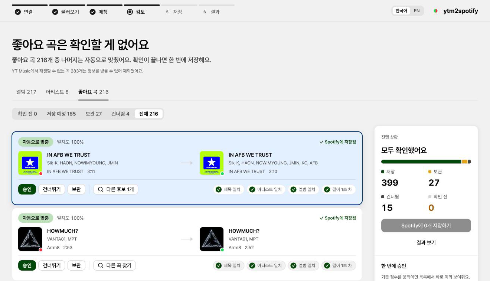

# ytm2spotify

YouTube Music 보관함(앨범, 구독 아티스트, 좋아요 곡)을 Spotify로 옮기는 로컬 도구입니다. 자동 매칭 결과를 양쪽으로 나란히 놓고 검토한 뒤 저장합니다.

*A local tool that moves a YouTube Music library to Spotify, with a side-by-side review of every match before saving.*

> **중단된 프로젝트입니다 (2026-10-13).** v0.0.1은 동작하고 실제 이전에도 썼습니다. 하지만 TuneMyMusic 같은 기존 서비스보다 나은 점이 없어 개발을 멈췄습니다. → [중단 결정 (ADR-006)](docs/adr/006-stop-project.md) · [회고](docs/RETROSPECTIVE.md)
>
> *Discontinued: it works, but offers no real advantage over existing services.*



## 무엇을 했나

이틀 동안(2026-10-12 ~ 13) 실무 개발 과정을 그대로 따라 해 보는 사이드 프로젝트였습니다. 기획 → 기술 검증(Spike) → 설계 → 구현 → 실사용 → 중단 결정 순서로 진행했고, 단계마다 결정을 문서로 남겼습니다.

- **매칭 엔진**
  - 제목, 아티스트, 앨범, 길이로 점수를 매겨 "자동 / 확인 필요 / 다른 버전 / 없음"으로 분류합니다.
  - 한글/로마자 표기 차이와 라틴 악센트를 처리합니다.
  - 사용자 업로드 영상(커버, 리믹스, 풀앨범)을 따로 구분합니다.
- **검토 화면:** 양쪽 곡을 비교 카드로 보여 줍니다. 기준 점수 이상은 한 번에 승인할 수 있고 단축키도 있습니다. 한국어와 영어를 지원합니다.
- **안전장치:** Spotify에 이미 있는 항목은 다시 저장하지 않습니다. 진행 상태를 SQLite에 저장해 중간에 끊겨도 이어서 할 수 있고, 저장한 것을 전부 되돌리는 `undo` 명령이 있습니다.
- **실사용:** 앨범 208개, 아티스트 6명, 좋아요 곡 177곡을 옮겼습니다. 앨범은 94%가 자동으로 매칭됐습니다.

## 문서

| 문서 | 내용 |
|---|---|
| [회고](docs/RETROSPECTIVE.md) | 잘한 점, 배운 점(경쟁 조사, 구현 형태, 차별점) |
| [PRD](docs/PRD.md) | 문제 정의, 목표, 기능 요구사항 |
| [Spike 리포트](docs/spikes/m0-report.md) | Spotify/YT Music API를 실제 계정으로 검증한 결과. 문서와 다르게 동작한 부분, 검색 할당량 |
| [설계](docs/DESIGN.md) | 구조, 데이터 모델, 매칭 알고리즘, 검토 화면 피드백 반영 기록 |
| [ADR](docs/adr) | 001 Python · 002 SQLite · 003 한/영 · 004 로컬 웹앱 · 005 자동 재개 · 006 중단 |

## 기술 스택

Python (FastAPI, `ytmusicapi`, SQLite) · React + TypeScript (Vite, Astryx 디자인 시스템). 서버는 `127.0.0.1`에서만 동작하고, 데이터와 인증 정보는 PC 밖으로 나가지 않습니다.

## 실행 (개발용)

설정 마법사는 만들지 않았습니다. 그래서 직접 해야 하는 단계가 있습니다.
- Spotify: Premium 계정으로 [개발자 앱](https://developer.spotify.com/dashboard/create)을 만들고 Client ID를 준비합니다.
- YT Music: 브라우저에서 요청 헤더를 복사해 `spikes/output/ytm_headers.txt`에 붙여넣습니다.

```sh
python3 -m venv .venv && .venv/bin/pip install -e '.[dev]'
(cd web && npm install && npm run build)

.venv/bin/python spikes/spotify_probe.py auth <CLIENT_ID>   # Spotify 로그인
.venv/bin/python spikes/ytm_probe.py setup                  # YT Music 연결 (헤더 파일은 바로 삭제됨)
./y2s import-auth spikes/output                             # 두 인증 정보를 앱 데이터 폴더로 가져오기

./y2s sync     # 양쪽 보관함 읽기
./y2s match    # 매칭 (Spotify 검색 할당량은 하루 약 540회)
./y2s serve    # 검토 화면 열기 → 저장
```

## License

[MIT](LICENSE)
